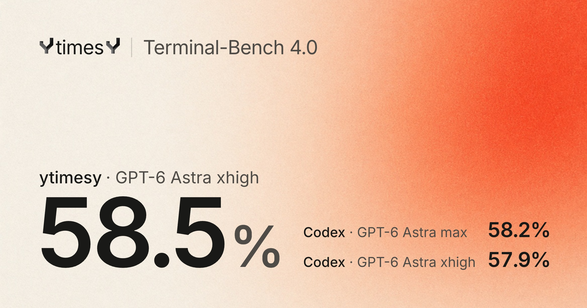
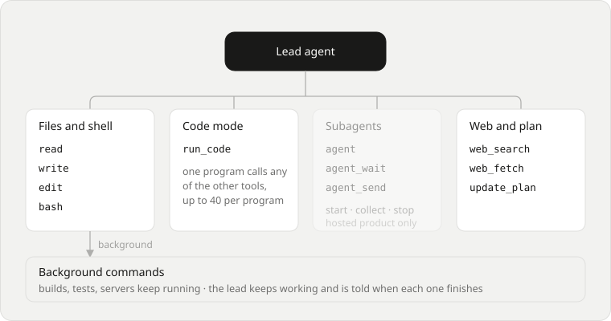

# ytimesy harness

Two MIT-licensed packages from [ytimesy](https://ytimesy.com).

| Package | What it is |
| --- | --- |
| [`@ytimesy/harness`](packages/harness) | The ytimesy coding agent as a standalone local engine. It runs on your computer with your own model API key (Anthropic, OpenAI, Google or OpenRouter) and talks only to that provider. No ytimesy account or server is involved. |
| [`ytimesy`](packages/ytimesy-cli) | A command line that moves your local coding-agent sessions (Claude Code, Codex, Cursor and more) to your ytimesy account. It talks to ytimesy.com by design: that hand-off is its whole purpose. |

```sh
npx @ytimesy/harness "Find why the date parser rejects 2026-02-29 and fix it"
```

## Benchmark



Terminal-Bench 4.0, GPT-6 Astra in every column, all 66 tasks, five attempts
each. The full table, intervals, cost, time and public Harbor jobs are in the
[harness README](packages/harness/README.md#benchmark) and the write-up
[Introducing ytimesy harness 1.0](https://ytimesy.com/blog/harness-1-0).

## How it works



The [harness README](packages/harness/README.md#how-it-works) explains the tools, code mode and the clean-copy check with diagrams. The dimmed Subagents box is the hosted product's delegation, which these packages do not include.

## Develop

Node.js 22.13 or newer and pnpm.

```sh
pnpm install
pnpm typecheck
pnpm test
pnpm build
```

`pnpm build` writes `packages/harness/dist/ytimesy-harness.mjs` and
`packages/ytimesy-cli/dist/ytimesy.mjs`.

## License

MIT, see [LICENSE](LICENSE). The ytimesy name and logo are not licensed under MIT.
