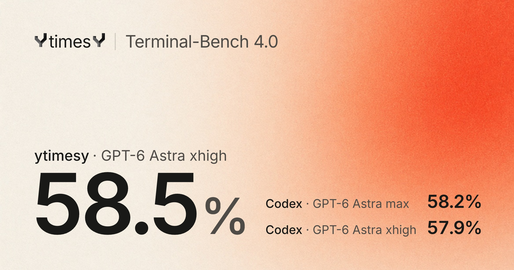
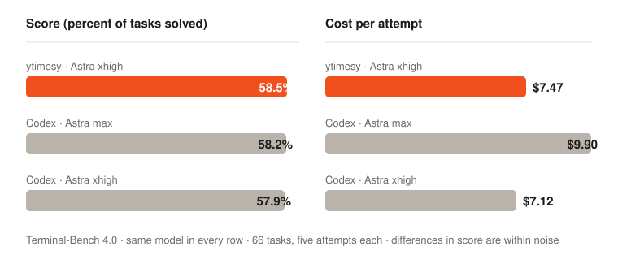
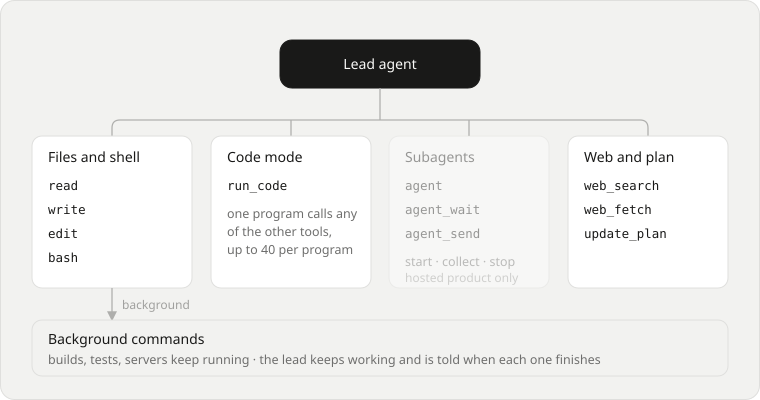
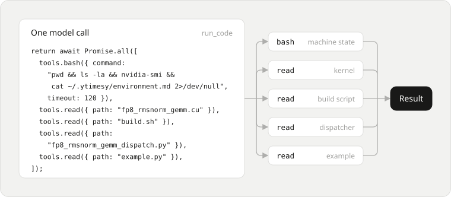
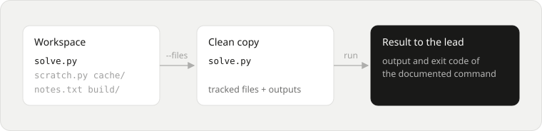

# @ytimesy/harness

The ytimesy coding agent, runnable on your own computer. It is the same model
loop, tool surface and instructions the ytimesy cloud product runs for a single
agent, with your working directory as the machine and your own API key as the
model.

Want it hosted, with parallel agents on their own cloud machines, a real browser
and pull-request automation? That is [ytimesy](https://ytimesy.com).

```sh
export ANTHROPIC_API_KEY=...        # or OPENAI_API_KEY, GEMINI_API_KEY, OPENROUTER_API_KEY
cd your-project
npx @ytimesy/harness "Find why the date parser rejects 2026-02-29 and fix it"
```

The agent reads and edits files, runs shell commands, searches the code base
and runs checks in the current directory. Progress goes to stderr, the final
answer to stdout.

## Benchmark





Terminal-Bench 4.0, GPT-6 Astra in every column, all 66 tasks, five attempts
each. Small figures are 95% intervals.

| | ytimesy (Astra xhigh) | Codex (Astra max) | Codex (Astra xhigh) |
| --- | --- | --- | --- |
| Score | **58.5%** (47.9-68.8) | 58.2% (47.6-68.5) | 57.9% (47.3-68.2) |
| Difference from ytimesy | - | -0.3 (-6.1 to +4.8) | -0.6 (-6.4 to +5.5) |
| Tasks solved at least once | **49 of 66** | 47 of 66 | 46 of 66 |
| Cost per attempt | $7.47 | $9.90 | **$7.12** |
| Total cost | $2,466 | $3,267 | **$2,351** |
| Input tokens per attempt | **3.34M** | 4.56M | 3.60M |
| Output tokens per attempt | 48k | 73k | **45k** |
| Time per attempt | 33.2 min* | 43.4 min | 33.3 min |
| Public Harbor job | [6aacc762](https://hub.harborframework.com/jobs/6aacc762-8e07-4be2-ab4e-17495141235d) | [0f01715e](https://hub.harborframework.com/jobs/0f01715e-2f98-40e3-836f-1ac4fdce39a4) | [caf6e433](https://hub.harborframework.com/jobs/caf6e433-9fff-4475-b0bc-977f14ac7052) |

The difference between ytimesy and Codex at Astra xhigh is within noise. Cost is
OpenAI list price; ytimesy's is computed from its token counts. \*Converted to
OpenAI speed so all three columns are timed on the same API; the blog post
explains the conversion. Read the full write-up: [Introducing ytimesy harness
1.0](https://ytimesy.com/blog/harness-1-0).

These scores are for the ytimesy harness as run on Harbor with the hosted
setup (October 29 to November 1, 2026). This package is its single-agent local
configuration and has not been scored on the benchmark separately.

## How it works



One lead agent works on your task with a small set of tools: `read`, `write`,
`edit` and `bash`, `run_code`, `web_fetch` and `update_plan`, plus the
provider's hosted web search. Builds, tests and servers can keep running in the
background from `bash`; the agent is told when each one finishes. The dimmed
Subagents box is the hosted product's delegation, which this package does not
include.



With `run_code` the agent writes one short JavaScript program that calls its
other tools, runs the independent calls in parallel and gets back a single
result. This is a real program from one of ytimesy's runs: one command and four
file reads in one model call.



Before finishing, the agent can run `ytimesy-check`. It copies only what is
delivered (the Git-tracked files and declared outputs) into a clean environment
and runs the documented command there, which catches work that only runs on the
agent's own machine.

## Read this first

The agent runs shell commands on your computer, as you, with your files and
your environment, and nothing asks you first. A model can be wrong, or be
steered by text it reads in a file or a web page. It does not stop at the
working directory: commands can read and change anything you can. Run it in a
checkout you can restore (read what it did with `git diff`), or in a container
or VM when the task or the repository is not yours.

## Requirements

- Linux, macOS, WSL2 or a Linux container. Native Windows is not supported;
  use WSL2.
- `python3` and `bash` on the `PATH`; `tmux` for long-running background
  commands (the agent is told when it is missing).
- Node.js 22 or newer.

If something fails on your machine, run it in a container:

```sh
docker run -it --rm -v "$PWD":/work -w /work -e ANTHROPIC_API_KEY node:22 \
  npx @ytimesy/harness "your task"
```

## Options

| Option | Meaning |
| --- | --- |
| `--cwd <dir>` | Work in this directory (default: the current one) |
| `--provider <name>` | `anthropic`, `openai`, `google` or `openrouter` (default: the first with an API key set) |
| `--model <id>` | Model id (default: the provider's flagship, see `src/local/providers.ts`) |
| `--base-url <url>` | Send the provider's requests to this URL, for a proxy or a compatible gateway |
| `--reasoning <level>` | `low`, `medium`, `high`, `xhigh` or `max` |
| `--variant <flags>` | Harness switches, e.g. `codeMode=primary,plan=off` |
| `--max-steps <n>` | Stop after this many model steps |
| `--no-search` | Turn off the provider's built-in web search (some free API keys have no search quota) |
| `--quiet` | Print only the final answer |

## What the agent is

`src/local/product-harness.ts` builds the agent: the tool surface for the
model's family (`read`, `write`, `edit`, `bash` and friends, in the shape that
model was trained on), `run_code` (code mode: one inference, several tool
calls), `web_fetch`, the provider's hosted web search on its own endpoint, an
`update_plan` checklist, and your repository's `AGENTS.md` / `CLAUDE.md`. The
loop (`src/server/services/model-agent-loop.ts`) handles streaming, retries,
context compaction and output limits. Switches the cloud product uses for
delegation and review loops are not available here; `--variant` names the ones
that are.

## What it writes and what it sends

- **Files.** The agent changes your working directory, as you asked. Besides
  that the harness itself writes only under `~/.ytimesy` (workspace commands in
  `bin/` and `lib/`, saved context in `history/`, long-run archives in
  `archives/`) and `/tmp/ytimesy-api-command-scopes` (one small folder per run
  for process records). Nothing is linked into a system directory and no shell
  profile is edited.
- **Network.** Requests go to the model endpoint you chose: the provider's own
  API, or `--base-url`. There is no telemetry, no analytics and no update
  check. File contents leave your computer inside requests to that endpoint,
  and through commands and `web_fetch` calls the agent makes (they show in the
  progress output). With `--provider openrouter` the public model list at
  openrouter.ai is also read (no key, no files). On a provider's own endpoint
  the model may use that provider's hosted web search.
- **API key.** Read from the environment, held in memory and sent only to the
  endpoint above. It is not logged, not written to disk, and removed from the
  environment of the commands the agent runs.

## Use it from code

```ts
import { runLocalAgent } from "@ytimesy/harness/local/run-local-agent";

const { answer } = await runLocalAgent({
	prompt: "Add a --verbose flag to the CLI",
	cwd: process.cwd(),
	model: { provider: "anthropic", apiKey: process.env.ANTHROPIC_API_KEY! },
	onEvent: (event) => {
		if (event.type === "tool-call") console.error(event.name);
	},
});
```

The machine the agent works on is an `AgentMachines` object
(`src/server/services/agent-machines.ts`): run a command, read a file, write a
file. `localMachines()` runs them on this computer; a container, a remote
machine or a cloud VM can provide the same operations and the loop and tools do
not change.

## Not in this package

The cloud product's web app, its virtual machines, desktop browser, database,
billing, GitHub integration, delegation to other agents and the review loop.
They depend on its machines and database and stay closed. You can use all of
them at [ytimesy.com](https://ytimesy.com).

## Develop

```sh
pnpm install
pnpm exec vitest run packages/harness   # includes end-to-end runs against a scripted model and a fake API
node packages/harness/build.mjs         # bundles dist/ytimesy-harness.mjs
```

Two tests keep the package honest. `src/import-boundary.test.ts` fails if it
imports the product's adapters, authentication, jobs or cloud database and
infrastructure packages, or reads `process.env` outside an allowlist.
`src/self-contained.test.ts` bundles every file and fails if anything outside
this package (and the CLI's wire contract) is reached or an npm package is not
declared.

## License

The bundled command contains open-source packages; their licenses are in
`dist/THIRD_PARTY_LICENSES.txt`, shipped with the package.

[MIT](LICENSE). The ytimesy name and logo are not licensed under MIT.
